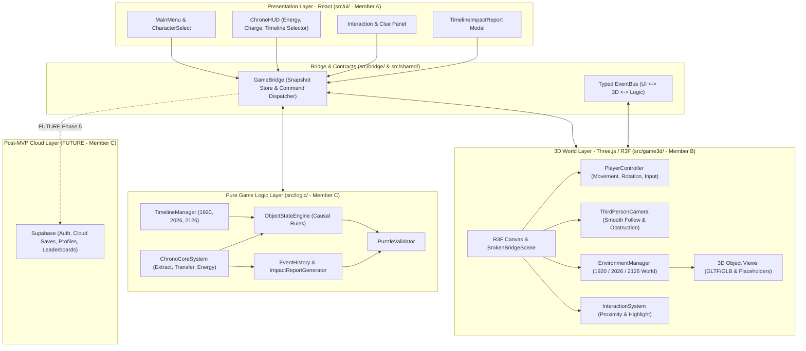

# System Architecture — TIME THIEF

**Status:** **PLANNED Architecture Specification** *(Repository currently contains documentation only; `package.json` and `src/` are not yet scaffolded.)*

---

## 1. Architectural Overview

**TIME THIEF** is a browser-based, **stylized low-poly 3D, third-person time-travel puzzle adventure** using a **strict three-layer decoupled client architecture** so three developers can work in parallel without merge conflicts or tight coupling:

1. **Presentation Layer (`src/ui/` — Member A):** React + TypeScript UI screens, menus, HUD, timeline selector, Chrono Energy display, interaction/clue panels, settings, and the Timeline Impact Report modal.
2. **3D Engine Layer (`src/game3d/` — Member B):** React Three Fiber (`<Canvas>`), Three.js 3D scenes, `@react-three/drei` helpers, optional `@react-three/rapier` physics/collisions, third-person `PlayerController`, `ThirdPersonCamera`, `EnvironmentManager`, interactive 3D object views (`GLTF/GLB` & low-poly placeholders), and `InteractionSystem`.
3. **Pure Logic Layer (`src/logic/` — Member C):** Pure TypeScript domain engine owning `TimelineManager`, `ChronoCoreSystem`, `ObjectStateEngine`, `PuzzleValidator`, `EventHistory`, and `ImpactReportGenerator`.
4. **Shared Contracts & Bridge (`src/shared/`, `src/bridge/` — Project Leader):** TypeScript interfaces, DARK CHRONO tokens, level schemas, and a lightweight typed `GameBridge` + `EventBus` connecting React UI, the 3D world, and pure game logic.

### Mandatory Architectural Boundaries
1. **React UI stays separate from 3D world implementation:** `src/ui/` renders 2D HTML/CSS overlays and never manipulates Three.js meshes, cameras, or physics bodies directly.
2. **React Three Fiber renders the 3D game inside a `<Canvas>`:** `App.tsx` mounts a thin `<GameCanvas />` host when gameplay is active, keeping 3D components inside `src/game3d/`.
3. **`src/logic/` remains 100% pure TypeScript:** It MUST NOT import `react`, `react-dom`, `three`, `@react-three/fiber`, `@react-three/drei`, `@react-three/rapier`, `window`, or `document`.
4. **The bridge layer mediates all cross-layer communication:** `src/bridge/` routes user/3D commands to `src/logic/` and broadcasts immutable state snapshots back to `src/ui/` and `src/game3d/`.
5. **Shared types and contracts come first:** `src/shared/` is finalized in Phase 1 before parallel Phase 2 work begins.
6. **Avoid monolithic components:** Never dump gameplay loop, physics, camera math, and UI into `App.tsx` or a single React component.
7. **Avoid unnecessary global state or tight coupling:** Use scoped subscriptions to `GameBridge` snapshots rather than bloated global stores.
8. **Deterministic truth lives in `src/logic/`:** The 3D scene visualizes state snapshots; it never invents or forks puzzle rules.

---

## 2. High-Level Architecture Diagram



---

## 3. React, Three.js & React Three Fiber Integration

### 3.1 Canvas Mounting & Overlay Composition
- `src/App.tsx` manages top-level screen routing (`MENU` | `CHARACTER_SELECT` | `GAMEPLAY` | `IMPACT_REPORT`).
- During `GAMEPLAY`, React renders a full-viewport container (`#10131C` background) containing:
  1. `<GameCanvas />` (`src/game3d/scenes/GameCanvas.tsx`): React Three Fiber `<Canvas shadows dpr={[1, 2]}>` rendering the active 3D scene.
  2. `<GameHUD />` (`src/ui/hud/`): Positioned above the canvas (`position: fixed/absolute`, `pointer-events: none` wrapper with `pointer-events: auto` on interactive HUD widgets).
- When returning to the Main Menu, unmounting `<GameCanvas />` lets React Three Fiber cleanly dispose WebGL resources.

### 3.2 Physics & Dependency Compatibility Note
- **Core 3D Stack:** `three`, `@react-three/fiber`, `@react-three/drei`, and optionally `@react-three/rapier` for rigid-body physics and colliders.
- **Phase 1 Compatibility Check:** Before installing dependencies in Phase 1, the Project Leader must verify React major version compatibility across `react`, `@react-three/fiber`, `@react-three/drei`, and `@react-three/rapier`.
- **Simple MVP Alternative:** If `@react-three/rapier` introduces bundler/WASM friction or feels overly heavy for a single-level MVP, `PlayerController` can use **deterministic AABB / cylinder-vs-box & river-plane boundary checks** in `src/game3d/systems/` while keeping the exact same interface.

---

## 4. Third-Person Gameplay Architecture (`src/game3d/` & `src/logic/`)

### 4.1 Component Responsibilities

| Component | Module | Core Responsibilities |
|---|---|---|
| **`PlayerController`** | `src/game3d/player/` | Reads `WASD`/Arrow keys (plus optional mobile virtual joystick), computes camera-relative XZ movement vector, smoothly rotates the character mesh toward movement direction, triggers walk/idle/interact animations, and applies collision resolution. |
| **`ThirdPersonCamera`** | `src/game3d/camera/` | Smoothly follows the player's world position with damped interpolation (`lerp`), supports gentle yaw orbit (mouse drag or `Q`/`E`), and prevents camera clipping behind cliffs/trees. |
| **`EnvironmentManager`** | `src/game3d/environment/` | Renders the shared 3D terrain, river, sky/fog, and era-specific lighting (`1920` warm amber, `2026` teal dusk, `2126` violet overgrowth) and toggles era-specific environment props cleanly. |
| **`InteractionSystem`** | `src/game3d/systems/` | Checks Euclidean distance between player and active 3D interactables each frame; selects the nearest valid target within `interactionRadius` (e.g., `3.0` world units), highlights it in **Chrono Cyan** (`#42D9D0`), and emits inspect/action commands to `GameBridge`. |
| **`TimelineManager`** | `src/logic/timeline/` | Tracks `activeTimeline` (`'1920' | '2026' | '2126'`), validates era switches, and enforces timeline switching energy cost (`0` in MVP). |
| **`ChronoCoreSystem`** | `src/logic/chrono/` | Manages `chronoEnergy` (`100` max), `heldCharge` (`1` slot in MVP), and executes `EXTRACT` (`25` Energy) and `TRANSFER` (`25` Energy); reserves `FREEZE`, `ACCELERATE`, and `RESTORE` command hooks for Post-MVP. |
| **`ObjectStateEngine`** | `src/logic/puzzle/` | Holds per-object temporal states across all 3 eras and evaluates deterministic causal rules whenever an earlier-era object is modified. |
| **`PuzzleValidator`** | `src/logic/puzzle/` | Evaluates level win criteria (e.g., player reaches `chrono_anchor_2126` while `seed_tree` is in `GIANT_ROOT_BRIDGE` state in `2126`). |
| **`ImpactReportGenerator`** | `src/logic/reports/` | Transforms `EventHistory` and before/after world snapshots into a structured `TimelineImpactReport` for the React UI. |

### 4.2 MVP Gameplay Engineering Approaches

1. **Movement & Character Rotation:**
   - Camera-relative planar movement (`XZ` ground plane, `Y` height sampled from terrain/bridge/root surface).
   - Character quaternion smoothly slerps toward movement heading (`rotationSpeed * delta`).
2. **Collision Detection (Maintainable MVP Approach):**
   - **Option A (Rapier):** Static `RigidBody` colliders for riverbanks, impassable boulders, and era-conditional bridge/root walkable colliders; kinematic character collider for smooth slope/root traversal.
   - **Option B (Lightweight Custom Colliders — fallback if Rapier is deferred):** Explicit 2D/3D bounding boxes (`Box3`) for obstacles + walkable bridge/root zones toggled directly by `ObjectStateEngine` state (`isWalkableBridge: boolean`).
   - In both approaches, **walkability truth comes from `src/logic/` object states** so visual bridges and physical colliders never desync.
3. **Camera Obstruction Handling:**
   - Cast a lightweight Three.js `Raycaster` from the player's shoulder pivot toward the desired `ThirdPersonCamera` offset.
   - If environment geometry (cliff, giant trunk) intersects the ray closer than the target distance, pull the camera forward just inside the hit distance (`hitDistance - 0.35`) with smooth damping so the player never disappears behind terrain.
4. **Interaction Distance & Targeting:**
   - Each interactive 3D object has a world position and `interactionRadius` (default `2.8`–`3.5` units).
   - `InteractionSystem` finds the closest eligible object in the active timeline, informs `GameBridge` (`focusedObjectId`), and renders a floating Chrono Cyan ring/indicator in 3D space.
5. **Timeline Switching & Safe Positioning:**
   - All three timelines share **identical world origin `(0, 0, 0)` and landmark coordinates** (riverbank, bridge span, mature tree location, seed/young-tree/giant-tree location, and east-bank Chrono Anchor).
   - Switching eras (`1`/`2`/`3` or HUD button) swaps `activeTimeline` in `TimelineManager`.
   - **Soft-Lock Prevention:** Before finalizing a visual spawn in the target era, `src/game3d/` verifies whether the player's `(x, z)` lies inside a solid obstacle or over unbridged river water in the destination era; if blocked, the player is smoothly placed at the nearest safe riverbank anchor on their current side of the river.

---

## 5. Data Flow & State Synchronization

```text
[1. Input] User presses 'F' near 1920 Seed (in 3D scene) OR clicks "Transfer" / "2126" (in React HUD)
      │
      ▼
[2. Bridge Dispatch] GameBridge.dispatch({ type: 'TRANSFER_TIME', objectId: 'seed_plot' })
      │
      ▼
[3. Pure Logic (src/logic/)]
      ├─ ChronoCoreSystem verifies energy >= 25 and heldCharge === 'GROWTH_TIME'
      ├─ Deducts 25 Chrono Energy, clears heldCharge
      ├─ ObjectStateEngine updates seed_plot (1920: INFUSED → 2026: YOUNG_TREE → 2126: GIANT_ROOT_BRIDGE)
      ├─ EventHistory appends TemporalEvent
      ├─ PuzzleValidator checks win conditions
      └─ Returns new immutable GameStateSnapshot
      │
      ▼
[4. Bridge Broadcast] GameBridge notifies subscribed listeners
      ├──► [React UI (src/ui/)] updates Energy bar (75/100), clears Charge slot, updates Clue Panel
      └──► [R3F 3D World (src/game3d/)] swaps Seed mesh/scale/VFX, updates 2026/2126 colliders & materials
```

### Shared State Snapshot Contract (`src/shared/types.ts` — PLANNED)
```ts
export type TimelineId = '1920' | '2026' | '2126';

export interface GameStateSnapshot {
  levelId: string;
  status: 'MENU' | 'PLAYING' | 'PAUSED' | 'COMPLETED';
  selectedCharacterId: CharacterId;
  activeTimeline: TimelineId;
  chronoEnergy: number;          // MVP max: 100
  maxChronoEnergy: number;       // MVP: 100
  heldCharge: TimeCharge | null; // e.g., 'GROWTH_TIME'
  focusedObjectId: string | null;
  inspectedObjectId: string | null;
  objects: Record<string, WorldObjectRuntimeState>;
  eventHistory: TemporalEvent[];
  impactReport: TimelineImpactReport | null;
}
```

---

## 6. Asset & Model Replacement Strategy (`GLTF/GLB`)

To prevent art bottlenecks during MVP development:
1. **Stage 1 — Placeholder Low-Poly Primitives:** Member B builds the playable level using stylized flat-shaded Three.js primitives (`ConeGeometry`, `CylinderGeometry`, `BoxGeometry`, `DodecahedronGeometry`) wrapped inside dedicated `ObjectView` components (`TreeView.tsx`, `BridgeView.tsx`, `SeedPlotView.tsx`, `PlayerMesh.tsx`).
2. **Stage 2 — Swappable Visual Wrapper Pattern:** Each `ObjectView` accepts `(state, timeline)` props and maps them to either a placeholder primitive group OR a loaded `useGLTF('/assets/models/...')` `.glb` scene.
3. **Zero Logic Coupling:** Colliders, interaction radii, and `ObjectStateEngine` state keys remain identical when swapping placeholder meshes for finished low-poly `GLB` models.

---

## 7. Future Supabase Integration *(FUTURE — Phase 5)*

No backend exists or is required for the offline single-player MVP. In **Phase 5**, Member C will add `src/services/supabase/`:
- **Authentication:** Optional account login for cross-device progress.
- **Cloud Saves & Profiles:** Sync unlocked worlds, character cosmetics, and best level completions.
- **Leaderboards & Daily Challenges:** Store verified completion times, remaining Chrono Energy, and Daily Chrono Challenge streaks.
- Neither `src/game3d/` nor `src/logic/` will call Supabase directly; `GameBridge` or an app-level sync hook triggers cloud sync after level completion.

---

## 8. Final Target Folder Structure & Responsibilities *(PLANNED)*

```text
Time-Thief/
├── index.html                           # Vite HTML entry
├── package.json                         # Dependencies & npm scripts
├── tsconfig.json                        # Strict TypeScript configuration
├── vite.config.ts                       # Vite bundler configuration
├── public/
│   └── assets/
│       ├── models/                      # Member B: Low-poly GLTF/GLB characters, trees, bridges, props
│       ├── textures/                    # Member B: Stylized low-poly color palettes & ground textures
│       ├── audio/                       # Member B/A: Ambient era loops & Chrono Core SFX
│       └── fonts/                       # Member A: DARK CHRONO display/body fonts
├── src/
│   ├── main.tsx                         # React DOM entry point
│   ├── App.tsx                          # Thin top-level screen router hosting UI + GameCanvas
│   ├── shared/                          # Project Leader: Cross-layer contracts & constants
│   │   ├── theme.ts                     # DARK CHRONO hex palette & era accent colors
│   │   ├── types.ts                     # TimelineId, GameStateSnapshot, Commands, Events
│   │   ├── characters.ts                # Arin Vale, Mira Sol, Kael Voss, Nyra Quinn metadata
│   │   └── levels.ts                    # Shared level IDs & landmark anchor coordinates
│   ├── bridge/                          # Project Leader: Cross-layer communication
│   │   ├── EventBus.ts                  # Typed pub/sub for transient VFX/SFX/interaction events
│   │   └── GameBridge.ts                # Connects GameStateManager to React UI & R3F 3D scene
│   ├── ui/                              # Member A: React UI (2D overlays only)
│   │   ├── components/                  # Reusable DARK CHRONO buttons, badges, modals
│   │   ├── screens/                     # MainMenu, CharacterSelect, SettingsModal, PauseModal
│   │   ├── hud/                         # GameHUD, TimelineSwitcher, ChronoEnergyBar, CluePanel, ImpactReport
│   │   └── styles/                      # darkChrono.css & responsive layout rules
│   ├── game3d/                          # Member B: Three.js / React Three Fiber 3D World
│   │   ├── scenes/                      # GameCanvas.tsx, BrokenBridgeScene.tsx
│   │   ├── player/                      # PlayerController.tsx, PlayerModel.tsx (Arin Vale)
│   │   ├── camera/                      # ThirdPersonCamera.tsx (follow + raycast obstruction)
│   │   ├── environment/                 # EnvironmentManager.tsx, RiverTerrain.tsx, EraLighting.tsx
│   │   ├── objects/                     # Interactive 3D entities (Tree, Bridge, SeedPlot, ChronoAnchor)
│   │   └── systems/                     # InteractionSystem.ts, CollisionHelpers.ts
│   └── logic/                           # Member C: Pure TypeScript (NO React/Three/R3F/Rapier/DOM)
│       ├── timeline/                    # TimelineManager.ts
│       ├── chrono/                      # ChronoCoreSystem.ts (Extract, Transfer, Energy rules)
│       ├── puzzle/                      # ObjectStateEngine.ts, PuzzleValidator.ts, levels/brokenBridge.ts
│       ├── history/                     # EventHistory.ts
│       ├── reports/                     # ImpactReportGenerator.ts
│       └── GameStateManager.ts          # Coordinates pure logic subsystems & emits snapshots
└── tests/
    └── logic/                           # Member C: Vitest unit tests for pure game logic
        └── brokenBridge.test.ts
```
