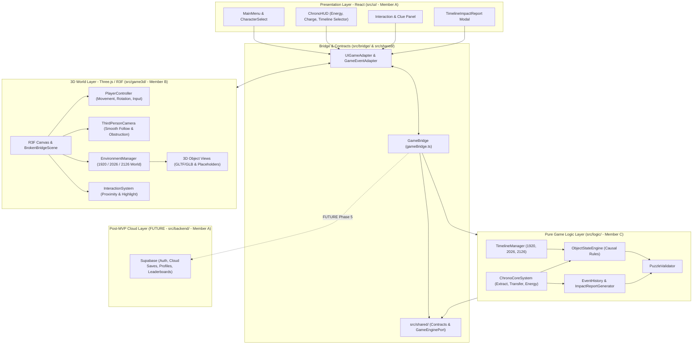

# System Architecture — TIME THIEF

**Status:** **Phase 1 Implemented / Phase 2 Ready** *(Vite + React + TypeScript + Three.js/R3F scaffold, baseline `GameCanvas`, `src/shared/`, and `src/bridge/` are **IMPLEMENTED**; Phase 2–4 gameplay modules are **PLANNED**; Phase 5 cloud/campaign features are **FUTURE**.)*

---

## 1. Architectural Overview

**TIME THIEF** is a browser-based, **stylized low-poly 3D, third-person time-travel puzzle adventure** using a **strict three-layer decoupled client architecture** so three developers can work in parallel without merge conflicts or tight coupling:

1. **Presentation & Backend Layer (`src/ui/` & `src/backend/` — Member A):** React + TypeScript UI screens, menus, HUD, timeline selector, Chrono Energy display, interaction/clue panels, settings, Timeline Impact Report modal, and post-MVP Supabase cloud integration (`src/backend/`).
2. **3D Engine Layer (`src/game3d/` — Member B):** React Three Fiber (`<Canvas>`), Three.js 3D scenes, `@react-three/drei` helpers, optional `@react-three/rapier` physics/collisions, third-person `PlayerController`, `ThirdPersonCamera`, `EnvironmentManager`, interactive 3D object views (`GLTF/GLB` & low-poly placeholders), and `InteractionSystem`.
3. **Pure Logic Layer (`src/logic/` & `tests/logic/` — Member C):** Pure TypeScript domain engine implementing `GameEnginePort` (from `src/shared/`) and owning `TimelineManager`, `ChronoCoreSystem`, `ObjectStateEngine`, `PuzzleValidator`, `EventHistory`, `ImpactReportGenerator`, and Vitest unit tests. Must NEVER import from `src/bridge/`, `src/ui/`, `src/game3d/`, React, or Three.js.
4. **Shared Contracts & Bridge (`src/shared/`, `src/bridge/` — Project Lead):** Single source of truth for TypeScript types, interfaces, `GameEnginePort`, contracts, and constants (`src/shared/`), plus the typed `GameBridge` and adapters (`src/bridge/`) and overall coordination/integration.

### Mandatory Architectural Boundaries
1. **React UI stays separate from 3D world implementation:** `src/ui/` renders 2D HTML/CSS overlays and never manipulates Three.js meshes, cameras, or physics bodies directly.
2. **React Three Fiber renders the 3D game inside a `<Canvas>`:** `App.tsx` mounts a thin `<GameCanvas />` host when gameplay is active, keeping 3D components inside `src/game3d/`.
3. **`src/logic/` remains 100% pure TypeScript:** It MUST NOT import from `src/bridge/`, `src/ui/`, `src/game3d/`, `react`, `react-dom`, `three`, `@react-three/fiber`, `@react-three/drei`, `@react-three/rapier`, `window`, or `document`. It depends solely on `src/shared/` (`GameEnginePort`).
4. **The bridge layer mediates all cross-layer communication:** `src/bridge/` routes user/3D commands to `src/logic/` and broadcasts immutable `GameSessionState` snapshots back to `src/ui/` and `src/game3d/`.
5. **`src/shared/` is the single source of truth:** Every developer must review relevant contracts in `src/shared/` before implementing their module, reuse existing shared types without creating duplicates, and keep their module compatible with `src/shared/`.
6. **Contract governance & coordination:** Propose new shared types/interfaces to the Project Lead before implementing; any change to `src/shared/` requires Project Lead review and approval. Multi-module changes must be coordinated across affected developers, and no member may directly modify another member's module without coordination.
7. **Avoid monolithic components:** Never dump gameplay loop, physics, camera math, and UI into `App.tsx` or a single React component.
8. **Avoid unnecessary global state or tight coupling:** Use scoped subscriptions to `GameBridge` snapshots rather than bloated global stores.
9. **Deterministic truth lives in `src/logic/`:** The 3D scene visualizes state snapshots; it never invents or forks puzzle rules.

---

## 2. High-Level Architecture Diagram



---

## 3. React, Three.js & React Three Fiber Integration

### 3.1 Canvas Mounting & Overlay Composition
- `src/App.tsx` manages top-level screen routing (`MENU` | `CHARACTER_SELECT` | `GAMEPLAY` | `IMPACT_REPORT`).
- During `GAMEPLAY`, React renders a full-viewport container (`#10131C` background) containing:
  1. `<GameCanvas />` (`src/game3d/scenes/GameCanvas.tsx`): React Three Fiber `<Canvas shadows dpr={[1, 2]}>` rendering the active 3D scene.
  2. `<GameHUD />` (`src/ui/hud/`): Positioned above the canvas (`position: fixed/absolute`, `pointer-events: none` wrapper with `pointer-events: auto` on interactive HUD widgets).
- When returning to the Main Menu, unmounting `<GameCanvas />` lets React Three Fiber cleanly dispose WebGL resources.

### 3.2 Physics & Dependency Compatibility Note
- **Core 3D Stack:** `three`, `@react-three/fiber`, `@react-three/drei`, and optionally `@react-three/rapier` for rigid-body physics and colliders.
- **Phase 1 Compatibility Check:** Before installing dependencies in Phase 1, the Project Lead must verify React major version compatibility across `react`, `@react-three/fiber`, `@react-three/drei`, and `@react-three/rapier`.
- **Simple MVP Alternative:** If `@react-three/rapier` introduces bundler/WASM friction or feels overly heavy for a single-level MVP, `PlayerController` can use **deterministic AABB / cylinder-vs-box & river-plane boundary checks** in `src/game3d/systems/` while keeping the exact same interface.

---

## 4. Third-Person Gameplay Architecture (`src/game3d/` & `src/logic/`)

### 4.1 Component Responsibilities

| Component | Module | Core Responsibilities |
|---|---|---|
| **`PlayerController`** | `src/game3d/player/` | Reads `WASD`/Arrow keys (plus optional mobile virtual joystick), computes camera-relative XZ movement vector, smoothly rotates the character mesh toward movement direction, throttles `UPDATE_PLAYER_POSITION` to `~10 Hz`, and applies safe positions returned by `src/logic/` on timeline switches. |
| **`ThirdPersonCamera`** | `src/game3d/camera/` | Smoothly follows the player's world position with damped interpolation (`lerp`), supports gentle yaw orbit (mouse drag or `Q`/`E`), and prevents camera clipping behind cliffs/trees. |
| **`EnvironmentManager`** | `src/game3d/environment/` | Renders the shared 3D terrain, river, sky/fog, and era-specific lighting (`1920` warm amber, `2026` teal dusk, `2126` violet overgrowth) and toggles era-specific environment props cleanly. |
| **`InteractionSystem`** | `src/game3d/systems/` | Checks Euclidean distance between player and active 3D interactables each frame; selects the nearest valid target within `interactionRadius` (`3.0` world units), highlights it in **Chrono Cyan** (`#42D9D0`), and dispatches `GameBridge` commands (`E` = Extract Time, `F` = Transfer Time, plus explicit interaction with `'chrono-anchor'` in `FUTURE`). |
| **`TimelineManager`** | `src/logic/timeline/` | Tracks `activeEra` (`'PAST' | 'PRESENT' | 'FUTURE'`), validates era switches (`0` energy cost in MVP), and determines safe player riverbank coordinates when switching timelines. |
| **`ChronoCoreSystem`** | `src/logic/chrono/` | Manages `currentEnergy` (`100` max), `heldCharge` (`1` slot in MVP), and executes `EXTRACT_TIME` (`25` Energy) and `TRANSFER_TIME` (`25` Energy); reserves Freeze, Accelerate, and Restore for Post-MVP. |
| **`ObjectStateEngine`** | `src/logic/puzzle/` | Holds per-object temporal states across all 3 eras and evaluates deterministic causal rules whenever an earlier-era object is modified. |
| **`PuzzleValidator`** | `src/logic/puzzle/` | Validates level completion when the player explicitly interacts with `'chrono-anchor'` in the `FUTURE` (`2126`) timeline while `'seed-plot'` is in `GIANT_TREE_ROOT_BRIDGE` state. |
| **`ImpactReportGenerator`** | `src/logic/reports/` | Transforms `EventHistory` and before/after world snapshots into a structured `LevelCompletionInfo` report for the React UI. |

### 4.2 MVP Gameplay Engineering Approaches

1. **Movement & Character Rotation:**
   - Camera-relative planar movement (`XZ` ground plane, `Y` height sampled from terrain/bridge/root surface).
   - Character quaternion smoothly slerps toward movement heading (`rotationSpeed * delta`).
2. **Collision Detection (Maintainable MVP Approach):**
   - **Option A (Rapier):** Static `RigidBody` colliders for riverbanks, impassable boulders, and era-conditional bridge/root walkable colliders; kinematic character collider for smooth slope/root traversal.
   - **Option B (Lightweight Custom Colliders — fallback if Rapier is deferred):** Explicit 2D/3D bounding boxes (`Box3`) for obstacles + walkable bridge/root zones toggled directly by `ObjectStateEngine` state (`isWalkableBridge: boolean`).
   - In both approaches, **walkability truth comes from `src/logic/` object states** so visual bridges and physical colliders never desync.
3. **Camera Obstruction Handling:**
   - Cast a lightweight Three.js `Raycaster` from the player's shoulder pivot toward the desired `ThirdPersonCamera` offset.
   - If environment geometry (cliff, giant trunk) intersects the ray closer than the target distance, pull the camera forward just inside the hit distance (`hitDistance - 0.35`) with smooth damping so the player never disappears behind terrain.
4. **Interaction Distance, Input & Targeting:**
   - Each interactive 3D object has a world position and `interactionRadius` (`DEFAULT_INTERACTION_RADIUS = 3`).
   - `InteractionSystem` finds the closest eligible object in the active timeline, informs `GameBridge` (`FOCUS_OBJECT`), and renders a floating Chrono Cyan ring/indicator in 3D space.
   - **Shared Command Routing:** Pressing `E` triggers Extract Time and `F` triggers Transfer Time in the 3D scene; React HUD buttons also trigger Extract Time and Transfer Time. Both input paths dispatch the exact same `GameBridge` commands (`EXTRACT_TIME` / `TRANSFER_TIME`).
5. **Timeline Switching & Safe Positioning:**
   - All three timelines share **identical world origin `(0, 0, 0)` and landmark coordinates** (riverbank, bridge span, mature tree location, seed/young-tree/giant-tree location, and east-bank Chrono Anchor).
   - Switching eras (`1`/`2`/`3` or HUD button) routes through `GameBridge` to `TimelineManager`.
   - **Logic-Authoritative Soft-Lock Prevention:** Pure logic (`src/logic/`) validates the destination era and determines the safe world position (e.g., clamping to `WorldLayout.safeWestBankAnchor` or `safeEastBankAnchor` if the player's `(x, z)` would land over unbridged river water or inside solid geometry), returning the resolved `player.position` in `GameSessionState`. The 3D system (`src/game3d/`) applies that returned position to the player character.
6. **Player Position Sync & Puzzle Completion:**
   - `PlayerController` throttles `UPDATE_PLAYER_POSITION` dispatches to approximately `10 Hz` (~`100 ms` intervals) to avoid unnecessary React HUD updates every rendered frame.
   - Level completion requires the player to **explicitly interact with `'chrono-anchor'` in the `FUTURE` (`2126`) timeline**; `PuzzleValidator` in `src/logic/` validates the win condition and emits `PUZZLE_COMPLETED`.

---

## 5. Data Flow & State Synchronization

```text
[1. Input] User presses 'E' (Extract) / 'F' (Transfer) in 3D scene OR clicks Extract / Transfer / Timeline button in React HUD
      │
      ▼
[2. Bridge Dispatch] Both inputs use the same GameBridge commands (uiAdapter.transferTime('seed-plot') / bridge.dispatchCommand(...))
      │
      ▼
[3. Pure Logic (src/logic/ implementing GameEnginePort from src/shared/)]
      ├─ ChronoCoreSystem verifies energy >= 25 and heldCharge.essence === 'GROWTH_TIME'
      ├─ Deducts 25 Chrono Energy, clears heldCharge
      ├─ ObjectStateEngine updates 'seed-plot' (PAST: INFUSED → PRESENT: YOUNG_TREE → FUTURE: GIANT_TREE_ROOT_BRIDGE)
      ├─ EventHistory appends GameEvent (CHRONO_ACTION & OBJECT_STATE_CHANGED)
      ├─ PuzzleValidator checks win conditions
      └─ Returns LogicStepResult { state: GameSessionState, events: GameEvent[] }
      │
      ▼
[4. Bridge Broadcast (gameEventAdapter.ts)]
      ├──► [React UI (src/ui/)] UIHudEventSink updates Energy bar (75/100), clears Charge slot, updates Clue Panel
      └──► [R3F 3D World (src/game3d/)] World3DEventSink swaps Seed mesh/scale/VFX, updates 2026/2126 colliders & materials
```

### Shared Contracts & Pure Engine Port (`src/shared/` & `src/bridge/` — IMPLEMENTED)
All cross-module types, constants, and `GameEnginePort` live in `src/shared/` (re-exported via `src/shared/index.ts`), including `GameSessionState`, `TimelineState`, `ChronoCoreState`, `ChronoActionRequest`, `WorldObject`, `EraObjectState`, `PuzzleState`, `GameEvent`, `GameEnginePort`, `LogicStepResult`, and `constants.ts`. `src/logic/` implements `GameEnginePort` directly against `src/shared/` without importing `src/bridge/`, while `src/bridge/` (`gameBridge.ts`, `uiGameAdapter.ts`, `gameEventAdapter.ts`) coordinates React UI (`src/ui/`) and the 3D scene (`src/game3d/`).

---

## 6. Asset & Model Replacement Strategy (`GLTF/GLB`)

To prevent art bottlenecks during MVP development:
1. **Stage 1 — Placeholder Low-Poly Primitives:** Member B builds the playable level using stylized flat-shaded Three.js primitives (`ConeGeometry`, `CylinderGeometry`, `BoxGeometry`, `DodecahedronGeometry`) wrapped inside dedicated `ObjectView` components (`TreeView.tsx`, `BridgeView.tsx`, `SeedPlotView.tsx`, `PlayerMesh.tsx`).
2. **Stage 2 — Swappable Visual Wrapper Pattern:** Each `ObjectView` accepts `(state, timeline)` props and maps them to either a placeholder primitive group OR a loaded `useGLTF('/assets/models/...')` `.glb` scene.
3. **Zero Logic Coupling:** Colliders, interaction radii, and `ObjectStateEngine` state keys remain identical when swapping placeholder meshes for finished low-poly `GLB` models.

---

## 7. Future Supabase Integration *(FUTURE — Phase 5)*

No backend exists or is required for the offline single-player MVP. In **Phase 5**, Member A will implement `src/backend/` (`supabase/`, `services/`, `types/`):
- **Authentication:** Optional account login for cross-device progress.
- **Cloud Saves & Profiles:** Sync unlocked worlds, character cosmetics, and best level completions.
- **Leaderboards & Daily Challenges:** Store verified completion times, remaining Chrono Energy, and Daily Chrono Challenge streaks.
- Neither `src/game3d/` nor `src/logic/` will call Supabase directly; `GameBridge` or an app-level sync hook triggers cloud sync via `src/backend/` after level completion.

---

## 8. Final Target Folder Structure & Responsibilities *(Phase 1 Scaffold, `src/shared/` & `src/bridge/` IMPLEMENTED)*

```text
Time-Thief/
├── index.html                           # Vite HTML entry (IMPLEMENTED)
├── package.json                         # Dependencies & npm scripts (IMPLEMENTED)
├── tsconfig.json                        # Strict TypeScript configuration (IMPLEMENTED)
├── vite.config.ts                       # Vite bundler configuration (IMPLEMENTED)
├── vitest.config.ts                     # Vitest unit-test configuration (IMPLEMENTED)
├── public/
│   └── assets/
│       ├── models/                      # Member B: Low-poly GLTF/GLB characters, trees, bridges, props
│       ├── textures/                    # Member B: Stylized low-poly color palettes & ground textures
│       ├── audio/                       # Member B/A: Ambient era loops & Chrono Core SFX
│       └── fonts/                       # Member A: DARK CHRONO display/body fonts
├── src/
│   ├── main.tsx                         # React DOM entry point (IMPLEMENTED)
│   ├── App.tsx                          # Thin top-level shell hosting UI + GameCanvas (IMPLEMENTED)
│   ├── shared/                          # Project Lead: Single source of truth (IMPLEMENTED)
│   │   ├── constants.ts                 # Timeline constants, MVP energy costs, DARK CHRONO colors
│   │   ├── timeline.types.ts            # TimelineEra, TimelineState, TimelineTransition
│   │   ├── chrono.types.ts              # ChronoCoreState, ChronoActionRequest, ChronoActionResult
│   │   ├── world.types.ts               # WorldObject, EraObjectState, WorldLayout, WorldPosition
│   │   ├── puzzle.types.ts              # PuzzleStatus, PuzzleState, LevelCompletionInfo
│   │   ├── events.types.ts              # Discriminated union GameEvent types
│   │   ├── game.types.ts                # GameSessionState, PlayerState, LevelState, GameEnginePort
│   │   └── index.ts                     # Barrel re-exports for all shared contracts
│   ├── bridge/                          # Project Lead: Cross-layer integration bridge (IMPLEMENTED)
│   │   ├── bridge.types.ts              # BridgeCommand, BridgeCommandResponse, BridgeError, IGameBridge
│   │   ├── gameBridge.ts                # Central coordinator wiring GameEnginePort to UI & 3D sinks
│   │   ├── uiGameAdapter.ts             # UIGameAdapter for React screens, HUD, and modals
│   │   ├── gameEventAdapter.ts          # UIHudEventSink, World3DEventSink, GameSystemEventSink
│   │   └── index.ts                     # Barrel re-exports for bridge layer
│   ├── ui/                              # Member A: React UI (2D overlays only — Preview IMPLEMENTED, MVP Screens PLANNED)
│   │   ├── components/                  # Reusable DARK CHRONO buttons, badges, modals
│   │   ├── screens/                     # MainMenu, CharacterSelect, SettingsModal, PauseModal
│   │   ├── hud/                         # PreviewOverlay (IMPLEMENTED); GameHUD, TimelineSwitcher, CluePanel, ImpactReport (PLANNED)
│   │   └── styles/                      # darkChrono.css (IMPLEMENTED) & responsive layout rules
│   ├── backend/                         # Member A: Post-MVP Supabase integration (FUTURE)
│   │   ├── supabase/                    # Supabase client configuration
│   │   ├── services/                    # Auth, cloud saves, leaderboard services
│   │   └── types/                       # Backend DTOs and schema mappings
│   ├── game3d/                          # Member B: Three.js / React Three Fiber 3D World (Phase 1 Canvas IMPLEMENTED, Gameplay PLANNED)
│   │   ├── scenes/                      # GameCanvas.tsx (IMPLEMENTED), BrokenBridgeScene.tsx (PLANNED)
│   │   ├── player/                      # PlaceholderPlayer.tsx (IMPLEMENTED), PlayerController.tsx (PLANNED)
│   │   ├── camera/                      # ThirdPersonCamera.tsx (Baseline IMPLEMENTED, Follow/Obstruction PLANNED)
│   │   ├── environment/                 # LowPolyEnvironment.tsx (IMPLEMENTED), EnvironmentManager.tsx (PLANNED)
│   │   ├── objects/                     # Interactive 3D entities (Tree, Bridge, SeedPlot, ChronoAnchor — PLANNED)
│   │   └── systems/                     # InteractionSystem.ts, CollisionHelpers.ts (PLANNED)
│   └── logic/                           # Member C: Pure TypeScript (NO React/Three/R3F/Rapier/DOM — PLANNED)
│       ├── timeline/                    # TimelineManager.ts
│       ├── chrono/                      # ChronoCoreSystem.ts (Extract, Transfer, Energy rules)
│       ├── puzzle/                      # ObjectStateEngine.ts, PuzzleValidator.ts, levels/brokenBridge.ts
│       ├── history/                     # EventHistory.ts
│       ├── reports/                     # ImpactReportGenerator.ts
│       └── GameStateManager.ts          # Coordinates pure logic subsystems & emits snapshots
└── tests/
    └── logic/                           # Member C: Vitest unit tests (sharedContracts.test.ts IMPLEMENTED, brokenBridge.test.ts PLANNED)
```

---

## 9. Finalized MVP Integration Decisions *(Approved for Phase 2)*

1. **Input Ownership (`E` / `F` + React HUD Buttons):**
   - `E` triggers **Extract Time** and `F` triggers **Transfer Time** in the 3D scene.
   - React HUD buttons also support **Extract Time** and **Transfer Time**.
   - Both input paths dispatch the exact same `GameBridge` commands (`EXTRACT_TIME` and `TRANSFER_TIME`).
2. **Player Position Synchronization (`~10 Hz` Throttled):**
   - `PlayerController` throttles `UPDATE_PLAYER_POSITION` dispatches to approximately `10 Hz` (~`100 ms`), avoiding unnecessary React HUD re-renders on every rendered frame.
3. **Safe Timeline Switching Authority (Logic Decides, 3D Applies):**
   - Pure game logic (`src/logic/`) validates the destination timeline and determines the safe world position using `WorldLayout` bounds/anchors, returning it in `GameSessionState.player.position`.
   - The 3D system (`src/game3d/`) applies that returned position to the player character on timeline transitions.
4. **Puzzle Completion Trigger (Explicit Anchor Interaction in `FUTURE`):**
   - The player must **explicitly interact with the Chrono Anchor (`'chrono-anchor'`) in the `FUTURE` (`2126`) timeline**.
   - `PuzzleValidator` in pure game logic (`src/logic/`) validates completion and emits `PUZZLE_COMPLETED`.
